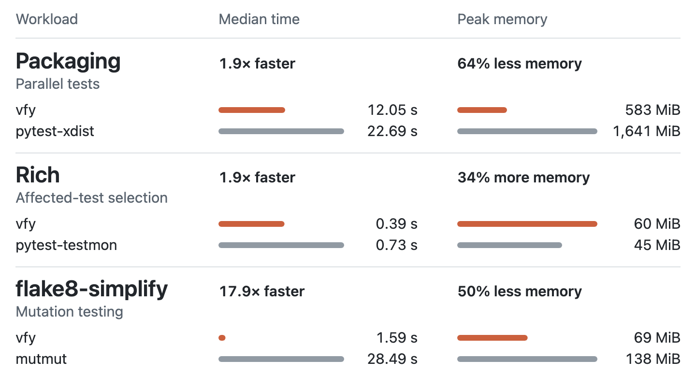

#  vfy

**A Python test runner and coverage tool, built in Rust.**

By default, vfy collects and runs pytest-style tests with its own engine.
You can measure coverage and rerun affected tests without installing pytest. Use [mutation testing](https://github.com/seanabreau/vfy/blob/main/docs/guides/mutation.md)
to find weak assertions and [decision coverage](https://github.com/seanabreau/vfy/blob/main/docs/guides/semantic.md)
to find untested conditions.

vfy is **Alpha**. [Documentation](https://vfy.neocline.com/) · [Compatibility](https://github.com/seanabreau/vfy/blob/main/docs/about/compatibility.md)

## Performance

<a href="docs/about/benchmarks.md#readme-chart">
  <picture>
    <source media="(prefers-color-scheme: dark)" srcset="docs/assets/workflow-benchmarks-dark.svg">
    <source media="(prefers-color-scheme: light)" srcset="docs/assets/workflow-benchmarks.svg">
    
  </picture>
</a>

See the [workloads and methodology](docs/about/benchmarks.md#readme-chart).

## Get started

On Linux or macOS with CPython 3.12+, install vfy with uv and run your tests:

```console
uv add --dev vfy
uv run vfy test
```

To measure lines and branches:

```console
uv run vfy test --cov=src --cov-branch --cov-report=term-missing
```

Replace `src` with your source directory. See [installation](https://github.com/seanabreau/vfy/blob/main/docs/getting-started/installation.md)
and the [coverage tutorial](https://github.com/seanabreau/vfy/blob/main/docs/getting-started/quickstart.md)
for a complete example.

## Run affected tests

Add `.vfy/` to `.gitignore` and commit your setup. From a clean Git checkout,
record a passing full run:

```console
uv run vfy test --all --cov=src
```

Edit a function, leave the change uncommitted, then rerun the same command
without `--all`:

```console
uv run vfy test --cov=src
```

vfy selects affected tests and combines fresh coverage with saved coverage from
skipped tests. Keep coverage and worker options the same between runs.
[Try the two-test tutorial](https://github.com/seanabreau/vfy/blob/main/docs/getting-started/selection.md).

## FAQ

### How do you pronounce vfy?

Say “verify.” Write it **vfy**, in lowercase.

### Can I use my existing pytest suite?

Yes. The default native engine supports pytest-style tests, fixtures, parametrization, and assertions. Install `vfy[pytest]` to run with pytest 9.1 or newer using `vfy test --engine=pytest`.
[Check plug-in and hook compatibility](https://github.com/seanabreau/vfy/blob/main/docs/about/compatibility.md)
for the features your suite uses.

### Does test selection replace full-suite CI?

No. Keep full-suite CI checks. Selection uses saved coverage and imports; external
services, environment variables, and shared test state can change without a
source edit. Use `--all` for those changes. Missing coverage or test and fixture
changes trigger a full run. [Selection rules](https://github.com/seanabreau/vfy/blob/main/docs/guides/test-selection.md).

### Which platforms does vfy support?

vfy 0.0.1 supports Linux and macOS. See the [installation guide](https://vfy.neocline.com/getting-started/installation/) for compatible wheels.

## Contributing

See [CONTRIBUTING.md](https://github.com/seanabreau/vfy/blob/main/CONTRIBUTING.md). For help, see
[troubleshooting](https://github.com/seanabreau/vfy/blob/main/docs/help/troubleshooting.md) or run `uv run vfy diagnostics`.

vfy is available under the Apache-2.0 or MIT license. See [NOTICE](https://github.com/seanabreau/vfy/blob/main/NOTICE)
for bundled third-party notices.
